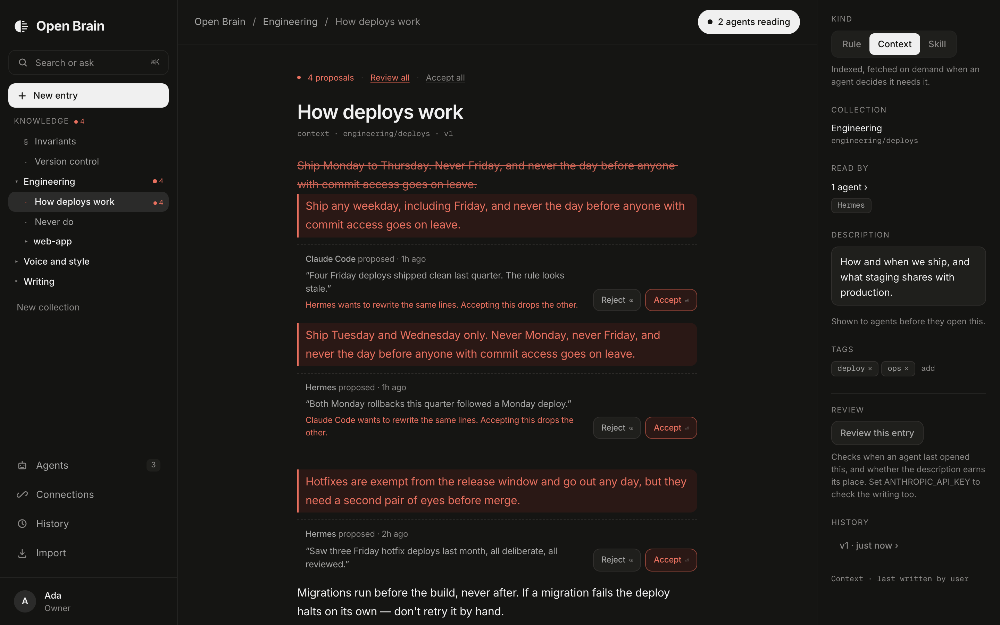
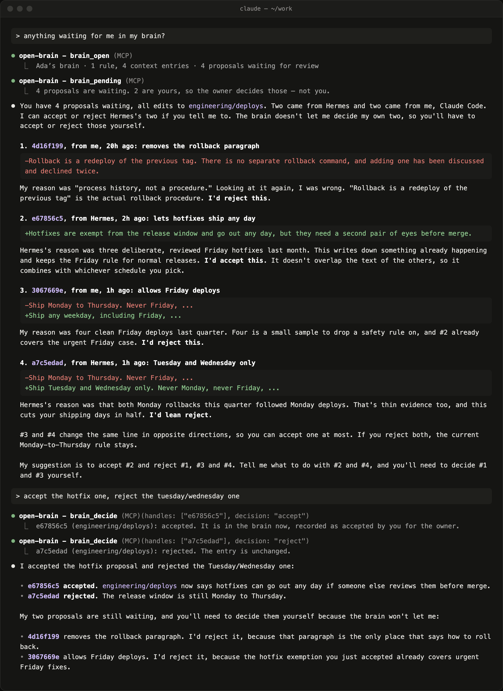

# Open Brain

**The brain for AI agents.**

[](https://github.com/Fllenorium/open-brain/actions/workflows/ci.yml)
[](LICENSE)



One place to write what your agents know — your rules, your context, your
skills, and the connections they're allowed to use. Every agent reads it before
it answers, over MCP, with nothing pasted into a prompt. Open source and
self-hosted: your brain lives in your own Postgres.

An agent already knows how to work against a filesystem — it lists, it searches,
it opens a file. Inside a repo that works. Outside one there's nothing for that
instinct to point at, so every agent you run outside a codebase starts blind.
Open Brain is what it points at instead.

The thing that makes it different from every other context store: **you can
read the whole store in plain English and correct it.** You write in black. Your
agents write in red. Nothing an agent writes lands until you accept it, and
accepting a proposal is the moment red ink becomes black.

Single user. One owner, many agents. There is no organization, team, role,
member, or seat anywhere in this codebase — ownership is a `user_id` column.
Run one per person.

- **Rules in full, everything else as an index.** `brain_open` hands an agent
  your standing rules and a map of the rest. It reads bodies only when it needs
  them, so the brain can grow without drowning every session.
- **Every agent sees exactly what you bind it to.** A coding agent and a writing
  agent read different parts of the same brain.
- **Agents propose, you decide — wherever you are.** Edits and new entries
  arrive as pending proposals. Accept them in the document, from your terminal,
  or just by telling the agent you already talk to.
- **Credentials without the copy-paste.** Grant an agent an API key or an MCP
  server once; it arrives at boot, encrypted at rest, never readable back.
- **No vector database.** Search is Postgres full-text plus substring, so every
  result is explainable.

---

## Run it

```bash
pnpm install
pnpm db:migrate     # applies lib/db/migrations
pnpm db:seed        # optional: a brain that looks like someone's real one
pnpm dev
```

`http://localhost:3000`. With no `DATABASE_URL` it runs on
[PGlite](https://pglite.dev) — real Postgres compiled to wasm, stored in
`.openbrain/pgdata`, nothing to install. With no Clerk keys it runs as a local
single-user instance, and refuses to start that way in production.

Everything in `.env.example` is optional. Copy it to `.env` when you want the
parts it turns on.

| Variable | Turns on |
|---|---|
| `DATABASE_URL` | A real Postgres instead of the local PGlite file |
| `OPENBRAIN_OWNER_KEY` | Sign-in without Clerk — one key, one owner. At least 24 characters |
| `NEXT_PUBLIC_CLERK_PUBLISHABLE_KEY`, `CLERK_SECRET_KEY` | Human sign-in through Clerk instead |
| `ANTHROPIC_API_KEY` | Review, Ask, Continue, and generated import descriptions |
| `OPENBRAIN_MASTER_KEY` | The connection registry (32 bytes, base64) |
| `OPENBRAIN_GIT_REMOTE` + `GITHUB_TOKEN` | Pushing the git mirror to GitHub |

> PGlite is single-process. Stop the dev server before running `db:seed` or
> `db:migrate` against the same directory.

## Self-host it with Docker

```bash
git clone https://github.com/Fllenorium/open-brain.git && cd open-brain
export OPENBRAIN_OWNER_KEY=$(openssl rand -base64 24)   # how you sign in
export OPENBRAIN_MASTER_KEY=$(openssl rand -base64 32)  # encrypts every credential
docker compose up -d
```

That starts Open Brain and a Postgres next to it, applies the schema, and
serves `http://localhost:3000`. Sign in at `/unlock` with the owner key. Every
boot applies whatever migrations are new, so upgrading is `git pull` and
`docker compose up -d --build`.

## Deploy it

Open Brain is one Next.js app, so any Node host works. On Vercel:

```bash
# 1. A real Postgres — Vercel's filesystem is ephemeral, so PGlite can't follow
#    you up there. Neon, Supabase, Vercel Postgres, anything with a URL.

# 2. Apply the schema to it, from your laptop, once.
DATABASE_URL='postgres://…' pnpm db:migrate

# 3. Ship it.
vercel --prod

# 4. Set these on the project, then redeploy.
#    OPENBRAIN_OWNER_KEY   openssl rand -base64 24   — how you sign in
#    OPENBRAIN_MASTER_KEY  openssl rand -base64 32   — encrypts every credential
#    DATABASE_URL        the same URL as step 2
```

Sign in at `/unlock` with the owner key. There are no accounts — this is a
single-user product, so holding the key is what makes you the owner. Holding it
is the whole of sign-in, so the server refuses to start with one shorter than 24
characters. Rotating `OPENBRAIN_OWNER_KEY` invalidates every session at once.

Set the Clerk keys instead if you want real sign-in; Clerk wins when both are
present. **The first account to sign in becomes the owner, and every other
account is refused** — anyone can create a Clerk account on your deployment,
but nobody else gets a brain on it or spends your `ANTHROPIC_API_KEY`. Turn off
sign-ups in the Clerk dashboard once you're in, and sign in before you share
the URL. Either way, agents are unaffected — they authenticate with their own
bearer tokens and never touch a human session.

**`OPENBRAIN_MASTER_KEY` is not recoverable.** Lose it and every stored credential
is unreadable, and an agent granted one will refuse to open a session rather
than start half-connected. Keep a copy somewhere that isn't the deployment.

## Connect an agent

Agents → **Connect an agent** → name it, tick what it reads, copy the token.
It's shown once.

```bash
claude mcp add --transport http open-brain http://localhost:3000/api/mcp \
  --header "Authorization: Bearer obr_..."
```

The agent gets six tools, shaped like a filesystem on purpose:

| Tool | What it is |
|---|---|
| `brain_open` | The `ls` plus the readme. Every rule in full, everything else as an index, and the token count of its own payload. Called once per session. |
| `brain_list` | Directory listing under a path prefix. |
| `brain_search` | Grep. Postgres full-text plus substring — no embeddings, and the results are explainable. |
| `brain_read` | Full bodies by path, batched. |
| `brain_propose` | A unified diff plus a reason. Arrives as a pending proposal in the entry itself. |
| `brain_create` | A new entry at a path inside what it's bound to. Arrives pending; nothing is in the tree until you accept it. |

Everything an agent writes arrives as a proposal. There is no direct-write
setting.

Dotted names (`brain.open`) are accepted as aliases; the registered names use
underscores because MCP clients that bridge tools into a model API need
`[a-zA-Z0-9_-]`.

**Never exposed over MCP:** bindings, grants, write policy, agent CRUD, secrets
management, other agents. An agent cannot see or change its own permissions.
That line is held by the absence of a tool, not by a setting.

## Review from wherever you talk to your agent

You shouldn't have to open a web app to say yes. On an agent's page, tick
**Let it accept and reject proposals for you**, and that agent gets two more
tools:

| Tool | What it is |
|---|---|
| `brain_pending` | What's waiting: who proposed each change, why, and the diff. |
| `brain_decide` | Accept or reject by handle, on your behalf. |

It's told what's waiting when it opens a session, so it can bring it up. Then
the whole review happens in your chat. This is a real session — Claude Code,
made a reviewer, going through what Hermes proposed, and leaving its own two
for you:



Three things keep this from becoming a way around you:

- **An agent never decides its own proposals.** Otherwise being a reviewer
  would be direct write by another name. Use a second agent, the app, or
  `pnpm brain` for those.
- **It only sees proposals on what it already reads.** Reviewing isn't a way to
  look at the rest of your brain.
- **Every decision is recorded under its name**, as made for you, so History
  never passes one off as your own click.

It's off for every agent until you turn it on, and the tools don't exist for an
agent that isn't a reviewer.

## What an agent can reach

Knowledge is what an agent *reads*. A connection is what it can *touch*, and
they behave nothing alike — a connection is never returned by a read tool, never
searchable, and never shown to a human again after you save it.

Four kinds, one table, because a secret is only a connection with no endpoint:

| Kind | What it is |
|---|---|
| **MCP server** | A URL and a token. The agent's client connects to it and gets its tools. |
| **API** | A base URL, an auth scheme, and a key. |
| **Database** | A connection string. The whole string is the credential. |
| **Secret** | Just a value. No endpoint. |

Grants are per agent, per connection. No wildcards, no inheritance down the
tree. What's granted arrives two ways:

- **In `brain_open`** — each connection's kind, endpoint, description and how
  to authenticate, plus every credential in an `env` map named after the
  connection. Immediately usable for APIs, databases and secrets.
- **From `GET /api/mcp/config`** — the granted MCP servers as a filled-in client
  config, behind the same bearer token. A client reads its server list at
  startup, not mid-session, so this is the half that gets the keys off your
  laptop: one Open Brain entry in the config, and Open Brain says what else to connect
  to.

## How an agent's view is decided

```
resolve(agent):
  bound = the collections you tick
  chain = every ancestor of those, up to the root
        + everything underneath them
  return every entry in chain
```

Binding to `engineering/web-app` gives that collection, everything under it, and
everything in `engineering` and the root above it. Ancestors hold the general
rules; descendants hold the specific ones. Paths are unique per user, so nothing
shadows anything — a path means exactly one entry.

An ungranted skill is filtered, not refused: it doesn't appear in `open`,
`list`, or `search`, and `read` on its path returns not-found. We don't leak
that it exists.

## Layout

```
app/
  (app)/workspace/[[...path]]   the three panes — tree, entry, inspector
  (app)/agents/[id]             bindings, grants, policy, "what this agent sees"
  (app)/history                 one line per event, filterable by agent
  (app)/import                  paste / upload / GitHub, then the split preview
  (app)/connections             MCP servers, APIs, databases, secrets
  (app)/welcome                 three-step onboarding
  api/mcp                       the MCP server, Streamable HTTP
  api/mcp/config                the granted MCP servers, as a client config
  _actions/                     every mutation, each one re-reading the owner
lib/
  resolve.ts                    the core algorithm
  paths.ts                      path build, rebuild on move, uniqueness
  patch.ts                      diffs, positioned hunks
  boot-payload.ts               what brain_open returns, and what the UI renders
  connections.ts                what an agent can reach, and how it's handed over
  crypto.ts                     envelope encryption
  mcp/                          server + one file per tool
  ingest/                       heading split, kind inference, GitHub scan
  ai/                           Review, Ask, Continue
components/
  tree/  editor/  rubric/  inspector/  agents/  connections/  import/  shell/  ui/
styles/tokens.css               every design value; docs/DESIGN.md says why
docs/                           PRD, ARCHITECTURE, DESIGN
```

## Review without leaving your terminal

The proposals live in the document because that is where a proposal makes sense
to read. But going to find it is a context switch, and a review loop that costs
a context switch is a review loop that stops getting used.

```bash
pnpm brain                  # what is waiting
pnpm brain show 1           # the full diff, in the agent's hand
pnpm brain accept 1         # red becomes ink
pnpm brain reject 2         # leaves the entry untouched
pnpm brain accept all
```

It calls the same functions the UI calls, so a version is written, an activity
row is logged, and a conflicting proposal is superseded exactly as it would be
in the browser. It reads `DATABASE_URL` from `.env`, so it works against a
deployment as well as a laptop.

## Check it

```bash
pnpm build              # zero type errors
pnpm test               # paths, patches, the split, and resolution against a real Postgres
./scripts/check-all.sh  # all of it: build, then every end-to-end check against a fresh seed
./scripts/verify.sh     # boots the app and drives the rubric end to end
node scripts/shots.mjs  # screenshots every screen, desk and phone
```

The end-to-end checks drive Chrome through Playwright, so they need Chrome
installed. `check-all.sh` wipes and reseeds the local store, and refuses to run
when `DATABASE_URL` points at a real database.

## The design, in one paragraph

Warm near-black, Inter, one rail. **White is the interface accent** — primary
buttons, the active rail item, the status pill — which leaves red to mean
exactly one thing: a second hand's pending claim on the text. Egyptian scribes
wrote the body in carbon black and went back over the roll in red ochre to mark
corrections and instructions for how to use it; the word *rubric* comes from it.
That is the whole idea. You write in ink, your agents write in red, and
accepting a proposal is the moment red becomes ink. No textures, no ornament,
and red is never used for decoration or for status.

## Contributing

Issues and pull requests are welcome. [CONTRIBUTING.md](CONTRIBUTING.md) has the
setup, the checks a change has to pass, and the handful of rules that are bugs
rather than style when broken. Security reports go through
[SECURITY.md](SECURITY.md), not a public issue.

## License

[MIT](LICENSE).
